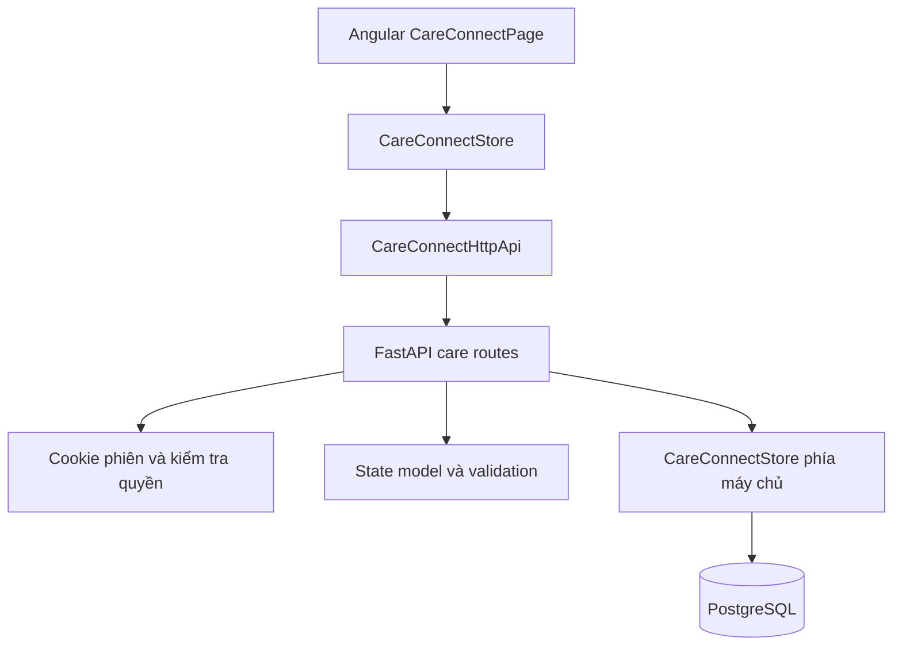

# Kiến trúc và phạm vi tách module

Luồng chính: tìm cơ sở → chọn dịch vụ → nhập nhu cầu → kiểm tra và đồng ý chia sẻ → gửi yêu cầu → nhân viên xem xét → thống nhất lịch → ghi nhận hoàn tất.

Máy chủ xác định người gửi từ phiên đăng nhập; không tin mã người gửi từ trình duyệt. Quyền hồ sơ gia đình và phân công cơ sở được kiểm tra riêng. Idempotency-Key bảo vệ việc gửi lại; expectedVersion và khóa giao dịch bảo vệ cập nhật đồng thời. Trạng thái yêu cầu và sự kiện lịch sử được ghi trong cùng giao dịch.

## Adapter của bản công khai

`backend/auth.py`, `backend/core/authz.py`, `backend/core/db/connection.py`, `backend/app.py` và shell Angular là các phần hỗ trợ riêng cho bản chạy thử. Chúng thay phụ thuộc vào hệ thống gốc; không tái hiện hệ thống xác thực hoặc hạ tầng của doanh nghiệp. Bảng `users`, `user_relative`, `user_profile`, `one_time_reminders` là hợp đồng lưu trữ tối thiểu mà module cần. Phần tiện ích mở rộng tập trung vào hai tính năng chính là chia sẻ hồ sơ có thời hạn và gửi cảnh báo thử nghiệm; các chức năng giải trí khác thuộc nền tảng gốc không nằm trong phạm vi module này.

Các tài nguyên thương hiệu gốc được thay bằng biểu tượng Care Connect. Chỉ xuất nhóm bản dịch và CSS token mà module sử dụng. Core của module, các API, bộ kiểm thử và lược đồ care_* được giữ cùng cấu trúc đường dẫn để đối chiếu với báo cáo.
